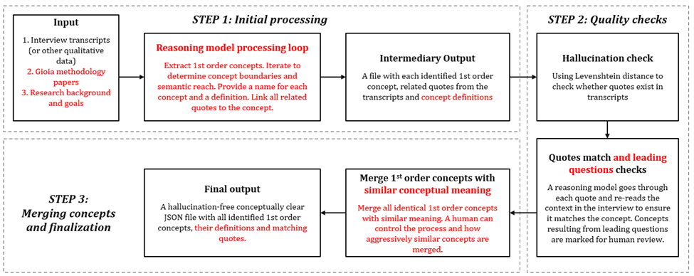
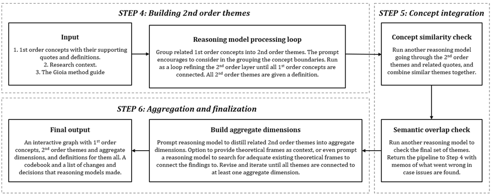
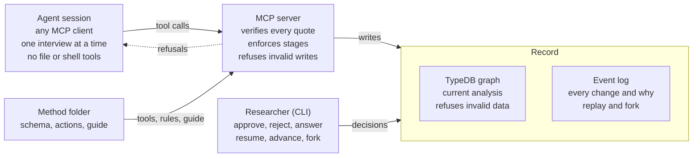
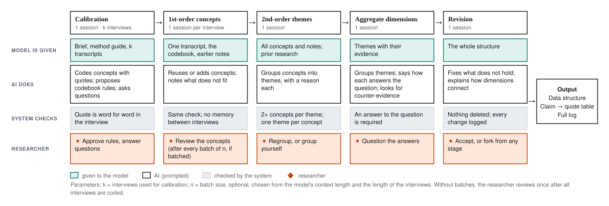
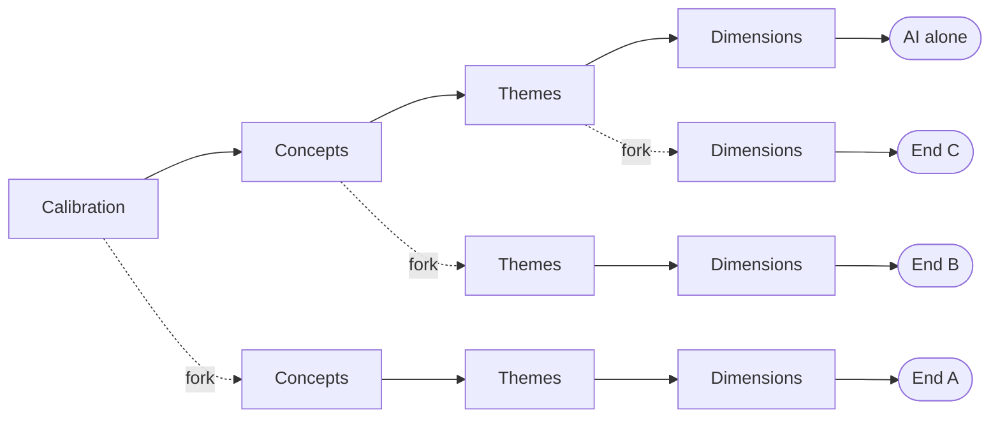

# Gioia-on-steroids (GOS)

**New here? Start with [How it works, in plain words](docs/how-it-works.md):** the steps in order, what is
checked, and where the researcher can step in, without technical detail. Stage figures: [docs/figures.md](docs/figures.md). Design notes: [docs/pipeline.md](docs/pipeline.md). Grew out of an earlier tool ([anonymized for review]).

In Gioia-on-steroids (GOS), AI agents carry out the steps of the Gioia method (Gioia et al., 2013) through a server that keeps the analysis in a graph database, verifies every quote against the transcript, and **refuses any entry that breaks the method's rules of evidence**. Every step is logged, so a run can be **replayed** exactly, **branched** at any step, and **compared** with other runs. GOS is implemented as the open-source package `qls`.

## How it works, at a glance

Interviews and the study brief go in. AI agents extract 1st-order concepts with their supporting quotes, the quotes are checked against the transcripts, and similar concepts are merged (Figure 1). The concepts are then grouped into 2nd-order themes and aggregate dimensions (Figure 2). The run stops at checkpoints along the way, where the researcher can step in.



*Figure 1 · The pipeline for extracting 1st-order concepts. It builds on an earlier pipeline ([anonymized for review]); red marks the changes made since.*



*Figure 2 · The pipeline for generating 2nd-order themes and aggregate dimensions, new in GOS.*

First-order coding (Figure 1) is the `calibrate` and `first_order` stages; the 2nd-order themes and aggregate dimensions (Figure 2) are the `themes`, `dimensions`, and `revise` stages. Each step in the figures maps to a stage or check in GOS 0.3.0, and [a table under Stages](#how-the-figure-steps-map-to-gos-030) says where the implementation differs from the figures. The same steps in plain words: [How it works](docs/how-it-works.md).

## Who uses it, and how

| You are | What you do | Start with |
|---|---|---|
| **A researcher** | Write the study brief, check the speaker roles, and decide at every checkpoint: answer the agent's questions, approve or reject its codebook proposals, revise or reject its concepts and themes, and move the run on. Read the results in a report or an interactive page. Everything is a command-line call or a generated page. | [How it works, in plain words](docs/how-it-works.md), then [Install](#install) and [Quick start](#quick-start) |
| **An AI agent doing the analysis** | Connect to the run's MCP server, read the brief and the guides, code one interview at a time, and stop at checkpoints. The server refuses what breaks the method, and the researcher's decisions are not among your operations. | [For AI agents](#for-ai-agents) |
| **An AI assistant setting GOS up for a researcher** | Install, ingest, create runs, start sessions, and build reports from the command line. The researcher's decisions stay with the researcher. | [For AI agents](#for-ai-agents) and the [Command reference](#command-reference) |

## Key facts

| Item | Detail |
|---|---|
| System | GOS, implemented as `qls` (package `qual-analysis-mcp-tools`), version 0.3.0, October 2026 |
| Repository | [anonymized for review] |
| Methods | Gioia; qualitative content analysis |
| Runs reported | A, B1 and B2, each end to end without human involvement ([Reported runs](#reported-runs)) |
| Models and harness | Any MCP client can connect to the server. The launcher and all reported runs used Claude Code with Claude models |
| Researcher interfaces | A command line for decisions; a generated report and an interactive site page for review |
| License | Apache 2.0 (TypeDB database: MPL-2.0) |

From [Architecture](#architecture) on, the sections follow the project's technical appendix (A1 to A11), in the same order.

## Install

You need Python 3.11 or later, a TypeDB 3 server (GOS 0.3.0 uses TypeDB 3.12), and, for `qls agent` and `qls pipeline`, Claude Code.

```bash
pip install -e ".[dev]"                  # add [docling] for PDF/DOCX/audio ingestion
```

TypeDB 3 server (one binary, MPL-2.0):

```bash
curl -LO https://repo.typedb.com/public/public-release/raw/names/typedb-all-linux-x86_64/versions/3.12.1/typedb-all-linux-x86_64-3.12.1.tar.gz
tar xzf typedb-all-linux-x86_64-3.12.1.tar.gz && cd typedb-all-linux-x86_64-3.12.1
./typedb server --storage.data-directory ./data --server.http.enabled false
# macOS / Windows builds and Docker (typedb/typedb:3.12.1): https://typedb.com/docs
```

`qls` connects to `127.0.0.1:1729` as `admin`/`password` by default; set `QLS_TYPEDB`, `QLS_TYPEDB_USER`, `QLS_TYPEDB_PASSWORD` (or `[typedb]` in `qls.toml`) otherwise. `qls doctor` checks the connection.

To check the installation: `qls --version` prints `qls 0.3.0`, and `qls doctor` reports whether TypeDB is reachable and the MCP SDK is installed. The launcher (`qls agent`, `qls pipeline`) looks for the `claude` command on your PATH; set `QLS_CLAUDE`, or `[agent] command` in `qls.toml`, if it is elsewhere.

## Quick start

```bash
qls init my-study && cd my-study
$EDITOR intent.yaml                      # the study brief: research question, method, stance; frozen into each run
qls ingest ~/interviews/*.docx           # txt/md/srt/vtt directly; other formats via Docling; prints the speaker roles to check
qls sources                              # check informant segments per transcript
qls run new r1                           # one TypeDB database per run
qls mcp-config r1 --actor agent:scholar-1 > .mcp.json
```

Three things to know before the first run:

- **No data yet?** The repository includes a synthetic corpus of three short interviews: `qls ingest path/to/this/repository/examples/synthetic/*.txt`.
- **The research question comes first.** `qls run new` refuses to create a run until `intent.yaml` holds your research question (or you pass `--question "..."`).
- **Check the speaker roles.** `qls ingest` prints which speaker labels it took as interviewer and which as informant, and only informants can be quoted. The default interviewer labels are `I`, `Q`, `H`, `Interviewer`, `Haastattelija`, and `Moderator` (`interviewer_labels` in `qls.toml`); add another with `qls ingest --interviewer LABEL`.

Open Claude Code in that folder; the `qls` server's operations appear as tools. Any other MCP client can connect to the server the same way, but no full run has used one yet. A starting prompt:

> Read intent(), method_guide() and ways_of_working(). We are calibrating: work through two interviews
> with begin(), then checkpoint() so I can review your concepts and the codebook.

The agent stops at the checkpoint; the server refuses every agent write until you have looked and resumed the run:

```bash
qls review r1                            # its questions and uncertainty memos first, then what changed
qls respond r1 --approve CB-1 --set use_when="..."
qls respond r1 --reject C-7 --reason "describes the tool, not the practice"
qls respond r1 --revise T-2 --set label="Working around the release cycle" --reason "closer to their words"
qls respond r1 --answer "Treat 'legacy' as a theme only when they describe change over time."
qls resume r1
```

For sessions in which the agent has the run's server and nothing else (no files, no shell), start them with `qls agent` instead ([Stages](#stages-checkpoints-and-feedback)).

Results:

```bash
qls report r1 --format html -o reports/r1.html   # Gioia figure, claim -> quote table, codebook, memos, decisions
qls site r1                                      # one self-contained, read-only HTML page of the whole run
qls run replay r1                                # rebuild from the log; the graph must be identical
qls run fork r1 --at 40 --as r1-alt              # branch after event 40 (another model, another scholar...)
qls compare r1 r2                                # which passages each run coded, and structure per level
qls query r1 'match $c isa concept, has id $i; not { theme-membership (concept: $c); }; select $i;'
```

Several scholars can work on one run at once (each with its own `--actor`): they share the graph and the codebook, and keep their own memos. `qls tool r1 add_concept '{...}' --actor agent:x` calls any operation from a shell.

## For AI agents

GOS is operated by AI agents as well as by people. What you may do depends on which of two roles you are in.

### If you are the agent doing the analysis

You reach GOS through the `qls` MCP server, bound to one run and one actor (`agent:NAME`).

1. Start with the task you were given, then call `intent()` (the research question: findings should answer it), `method_guide()`, `ways_of_working()`, and `status()`.
2. Work one interview at a time with `begin(source)`, and read the whole interview before coding anything.
3. Copy the informant's exact words when you add a concept. Quotes are checked in the same call; a quote that is not in an informant's answer is refused and nothing is saved. Re-read the passage and copy it again.
4. Give a reason for every quote, every membership link, and every change.
5. The current stage (`status()`) decides what you may write. If your task needs something the stage does not allow, say so in a memo or a checkpoint question; do not work around it.
6. Write down what you will need later as memos and codebook proposals, and look things up (`search`, `get`, `pack`, `memos`, `query`) instead of relying on recall.
7. When the task calls for it, call `checkpoint(summary, questions)` and stop. Every write is refused until the researcher resumes the run. When you resume, read `feedback()` first.

Approving, rejecting, answering, resuming, and changing stage are the researcher's operations, not yours. The full guides are the ones the server gives you: `ways_of_working()` (also `qls guide`, from `qls/agents/AGENTS.md`), `method_guide()` (also `qls method gioia`), and `guide(name)`. `qls tools r1 --actor agent:scholar-1` lists the operations an actor has.

### If you are an AI assistant running the command line for a researcher

Follow the steps in order, and check each one before the next.

| Step | Command | It worked if |
|---|---|---|
| Install | `pip install -e ".[dev]"`, and start TypeDB ([Install](#install)) | `qls --version` prints `qls 0.3.0`; `qls doctor` reports `TypeDB at ...: reachable` and `MCP SDK: installed.` |
| Create a project | `qls init my-study && cd my-study` | the folder holds `intent.yaml` and `qls.toml` |
| Write the brief | edit `intent.yaml` with the researcher's own research question, stance, and context | the placeholder text is gone; do not invent the research question |
| Add the interviews | `qls ingest FILES...` | each line reports informant segments and the right speaker roles; `qls sources` lists every transcript |
| Create a run | `qls run new r1` | `qls runs` lists `r1` |
| Start the analysis | `qls agent r1 --task calibrate --sources P01 P02 P03` for an isolated session, or `qls mcp-config r1 --actor agent:scholar-1 > .mcp.json` to attach a client | `qls status r1` reports the run's status (`waiting` at a checkpoint), its stage, and its object counts |
| Hand over | `qls review r1` | the researcher reads the agent's questions and decides |
| Results | `qls report r1 --format html -o reports/r1.html` and `qls site r1` | the files are in `reports/` |

Rules for this role:

- **The researcher's decisions are the researcher's.** `qls respond`, `qls resume`, and `qls stage` record decisions under the researcher's name: the command line does not check who is typing, and without `--actor` it logs them as `human:$USER`. Run them only to carry out a decision the researcher has given you, never to approve or resume work on your own judgment. For a run with no person in it, use `qls pipeline --auto`, whose decisions are logged as `auto:approve-all`.
- **Prefer isolated sessions.** A session started with `qls agent` has the run's MCP server and nothing else, so the analysis agent cannot reach the command line. A client attached with `qls mcp-config` keeps its other tools (in Claude Code, files and a shell); there the separation between agent and researcher rests on instructions.
- **Keep prior analyses away from the analysis.** Do not give analysis sessions published analyses of the same data, and do not look them up for them.
- **Treat outputs like the transcripts.** The event log (`qls.db`), session transcripts (`logs/`), reports, and the site page contain interview text. Do not commit, upload, or share them unless the researcher says so. `qls site` blacks out interviewee names unless `--keep-names` is given.
- **Do not edit a method folder under a running study.** A run refuses to continue, or to be forked, if its method's files have changed.

## Command reference

Every command takes `--project DIR`; by default `qls` searches upwards from the current folder, or uses `$QLS_PROJECT`. `qls --help` and `qls COMMAND --help` list all options.

```
Set up
  qls init DIR                          project folder with qls.toml and intent.yaml
  qls doctor                            check TypeDB and the MCP SDK
  qls ingest FILES... [--interviewer LABEL]   add sources (txt/md/srt/vtt, or anything Docling reads)
  qls sources                           list sources

Runs (one TypeDB database each)
  qls run new NAME [--intent FILE] [--question "..."] [--method gioia|content_analysis|DIR] [--sources P01 P02]
  qls run fork RUN --at N --as NAME     branch after event N
  qls run fork RUN --at-stage S --as NAME   branch at the start of stage S
  qls run replay RUN                    rebuild from the log; the graph must be identical
  qls run drop RUN                      delete the run and its database
  qls runs | status RUN | log RUN [--since N] | check RUN

Researcher at a checkpoint
  qls review RUN                        what happened since the last checkpoint; questions and uncertainty first
  qls respond RUN --approve ID [--set KEY=VALUE] | --reject ID --reason R
                  | --revise ID --set KEY=VALUE --reason R | --answer "..."
  qls resume RUN                        let agents continue
  qls stage RUN [STAGE|next]            show or move the run's stage (also resumes)

Agents
  qls mcp --run RUN --actor agent:NAME  MCP server (stdio); --actor reviewer:NAME connects read-only
  qls mcp-config RUN --actor agent:NAME print an .mcp.json entry
  qls tools RUN --actor A               list the operations an actor has
  qls tool RUN NAME '{"json": "args"}' --actor A   call any operation from the shell
  qls agent RUN --task TASK [--sources P01 ...] [--model M] [--web]   one isolated agent session (Claude Code)
  qls pipeline RUN --auto --calibration K [--batch N] [--seed S] [--until STAGE] [--model M]   all stages, AI-only policy
  qls sessions RUN | provenance RUN [--session ID]   who did what, with which prompt and model, having read what

Results
  qls report RUN [--format md|html] [-o FILE]
  qls site RUN [-o FILE] [--keep-names] one self-contained HTML page (reports/RUN-site.html by default)
  qls compare RUN_A RUN_B [--json]      agreement between two runs on informant segments
  qls query RUN 'match ... select ...;' read-only TypeQL
  qls methods | method NAME | guide     built-in methods; a method's guide; the ways-of-working guide
```

## Architecture

*Appendix A1.* GOS separates what software can check from what needs interpretation. A server holds the analysis and refuses any write that breaks the method's rules of evidence; the agents and the researcher interpret.



Agents reach the analysis only through the server. The researcher's approvals, answers, and stage changes enter through a command line that agent sessions have no tool to call.

| Component | What it is |
|---|---|
| **Server** (`qls mcp`) | An MCP server (Model Context Protocol, an open standard for connecting AI applications to tools). It exposes the operations below, verifies quotes, enforces stages and checkpoints, and logs every write. |
| **Graph store** | One TypeDB 3.12 database per run. The database checks the schema whenever changes are saved. |
| **Event log** | An SQLite ledger: transcripts (immutable and versioned), runs, every event with the database statements it ran, sessions, and a log of what the agent read. |
| **Agent harness** | One non-interactive Claude Code session per task, started by `qls agent` and connected only to the run's server: no file or shell tools, web tools only on request (`--web`), no user settings, no saved session. The launcher starts Claude Code only. Any other MCP client can connect to the server directly (`qls mcp-config`), but no full run has used one yet. |
| **Method folder** | The schema, operations, stages, guide, and task prompts that define a method ([Methods](#methods-gioia-and-qualitative-content-analysis)). |

### Schema

A core shared by all methods defines codes (claims made directly from the data) and categories (claims made from other claims); the Gioia method adds concepts, themes, and dimensions. These rules are our operationalization of the Gioia data structure, not rules stated by Gioia et al. (2013) (see Mees-Buss et al., 2022).

| Object | Records | Rules checked on save |
|---|---|---|
| Transcript | identifier and version | none |
| Quote | start and end character offsets in one transcript version, and its segment; never text typed by a model | belongs to exactly one transcript |
| Concept | label, description, optional in-vivo term, actor, event, codebook version | at least one quote, each with a reason; at most one theme |
| Theme | label, description | at least two concepts, each with a reason; at most one dimension |
| Dimension | label, description | at least one theme, each with a reason; states, with a reason, how it answers the research question |
| Memo | kind, level, text | about at least one object |
| Codebook entry | label, definition, when to use, when not to use, status, version, example quotes | status is proposed or active |
| Intent | research question, method, stance, study context, sensitizing concepts, prior research; one per run, frozen when the run is created | none |

Events and sessions are kept in the event log. A concept and its quotes are saved together or not at all.

### Operations exposed to the agent

| Group | Operations |
|---|---|
| **Orient** | `intent`, `method_guide`, `guide` (short how-tos), `ways_of_working`, `list_sources`, `status` (incl. the current stage), `check`, `feedback` |
| **Read** | `begin` (one interview with the codebook and notes), `read_source`, `search`, `get`, `pack` (the evidence behind an object), `memos`, `codebook`, `history`, `query` (read-only TypeQL) |
| **Method actions** | Gioia: `add_concept` (with quotes), `add_theme`, `add_dimension` |
| **Revise** | `add_evidence`, `add_to_group`, `remove_from_group`, `revise`, `merge`, `withdraw`, each with a reason |
| **Memory** | `memo`, `propose_codebook` |
| **Stop** | `checkpoint` (summary, questions) |

Approve, reject, answer, resume, and change stage are researcher operations in the command line and are never exposed to agents. Every write is tagged with its actor: `agent:`, `human:`, `reviewer:` (read-only), or `auto:` (a fixed policy standing in for the researcher).

### Researcher interfaces

Researchers audit and steer an analysis through a command line and two generated outputs: `qls report` (a Markdown or HTML report) and `qls site` (one self-contained, read-only HTML page).

| Interface | Where it is in GOS |
|---|---|
| Interactive Gioia graph | Site, Data structure view: dimensions, themes, and concepts, each opening its quotes and reasons, and a table of which interviews carry which themes. The report draws the Gioia figure. |
| Codebook | Site, Codebook view: the definition, when to use, when not to use, and status of each entry |
| Decision log | Site, Decision log view: every event with its actor, stage, objects, and reason. Step by step view: each session, checkpoint, and researcher decision. |
| Transcript views with highlighted codes ("who said what") | Site, Interviews view: each transcript with quoted passages highlighted and linked to their codes; interviewer turns shown apart |
| Contextual configuration | The study brief (`intent.yaml`) and the method folder, edited as files before a run and frozen into it. The site's Instructions view shows the brief, method guide, and task prompts the run was frozen with, and the ways-of-working guide of the installed version. |
| Cost tracking | The API-equivalent cost and duration that Claude Code reports for each session, recorded with the session and summed on the site |
| Researcher decisions | Command line only: `qls review`, `qls respond`, `qls resume`, `qls stage`, `qls run fork` |

## Stages, checkpoints, and feedback

*Appendix A2.* Each method declares its stages (`stages.yaml`) and what an agent may create and change in each. The server refuses any other action, only a researcher moves the run to the next stage, and every stage change is a logged event, so every stage boundary is a fork point.



Each stage as a sequence diagram: [docs/figures.md](docs/figures.md). The five Gioia stages, the task prompt each one runs (in `qls/methods/gioia/stages/`), and what an agent may create and change:

| Stage | Sessions and task prompt | Agent may create / change | Ends with |
|---|---|---|---|
| `calibrate` | one session on k interviews (`calibrate`) | concepts / concepts | checkpoint: codebook proposals, proposed concept fields, questions |
| `first_order` | one session per remaining interview (`first_order`); a consolidation session after each batch of n, or after all (`first_order_batch`) | concepts / concepts | checkpoint after each batch |
| `themes` | one session (`themes`) | themes / concepts and themes | checkpoint |
| `dimensions` | one session (`dimensions`) | dimensions / themes and dimensions | checkpoint; a negative-case memo per dimension |
| `revise` | one session (`revise`) | all three / all three | checkpoint; corpus memo with the grounded model |

Memos, codebook proposals, and checkpoints are allowed in every stage. Stage rules do not bind researchers.

```bash
qls stage r1 next                                  # researcher: move to the next stage
qls run fork r1 --at-stage themes --as r1-h        # branch where grouping began: all concepts, no themes
qls agent r1 --task first_order --sources P01      # one isolated Claude Code session for one task
qls pipeline r1 --auto --calibration 3             # every stage unattended: a fixed policy stands in at checkpoints
```

**Checkpoint protocol.** The agent calls `checkpoint` with a summary and its questions, and stops. The run is then waiting, and the server refuses every agent write until a researcher resumes it. The researcher reads the agent's questions and uncertainty memos first (`qls review`). They then answer, approve (optionally with edits) or reject codebook proposals, revise or reject objects with a reason, and resume or advance the run (`qls respond`, `qls resume`, `qls stage`). Each response is logged under the researcher's name.

**Feedback protocol.** The next session reads the researcher's responses with `feedback`. The `calibrate`, `themes`, and `dimensions` prompts tell a resumed session to read it first and apply it, with a reason for each change; the `first_order` and `revise` prompts read it while orienting. Each codebook approval raises the codebook version by one, and every concept records the version in force when it was made.

**Calibration loop.** Calibration can repeat before the rest is coded. At the calibration checkpoint the researcher answers, approves or rejects, and resumes; a new calibrate session (`qls agent r1 --task calibrate`) applies the feedback and checkpoints again. The loop ends when the researcher moves the run to `first_order`. This is how the level of concepts is set.

**Runs without a person.** `qls pipeline --auto` runs every stage unattended (for Gioia, give the size of the calibration sample with `--calibration K`; `--batch N` sets the batch size). At each checkpoint a fixed policy, logged as `auto:approve-all`, approves every pending codebook proposal as written, answers no questions, resumes the run, and, once a stage's task is done, advances the run to the next stage. Interview order comes from a seeded shuffle (seed 1 by default), and the calibration sample is its first k interviews. Runs A, B1, and B2 were run this way.

### How the figure steps map to GOS 0.3.0

Each step in [Figures 1 and 2](#how-it-works-at-a-glance) maps to a stage or check in GOS 0.3.0. Where the implementation differs from the figure, the table says so.

| Step in the figures | Where it happens in GOS 0.3.0 |
|---|---|
| Step 1 · Input | The study brief (`intent.yaml`: research question, context, prior research) and the method guide, frozen into the run |
| Step 1 · Reasoning model processing loop | The `calibrate` and `first_order` sessions: concepts with descriptions, quotes, and reasons; the calibration loop sets concept boundaries |
| Step 1 · Intermediary output | Concepts and quotes are saved to the graph database as they are written, not to a file |
| Step 2 · Hallucination check | At write time: exact, then normalized, then fuzzy match at 95 or more; an unmatched quote is refused |
| Step 2 · Quotes match and leading questions checks | Every quote link needs a reason, and each quote comes back with the interviewer question it answers; the revise session re-reads a sample of quotes. Concepts from leading questions are not yet marked automatically |
| Step 3 · Merge 1st-order concepts | The `first_order_batch` session merges near-duplicates, each with a reason; the researcher sets how fine-grained concepts are at the calibration checkpoint |
| Step 3 · Final output | The graph database and event log, exported by `qls report` and `qls site` |
| Step 4 · Input and processing loop | The `themes` session, which reads the prior research and sensitizing concepts for the first time; every theme has a description, and a check lists concepts not yet in a theme |
| Step 5 · Similarity and semantic overlap checks | Done inside the themes, dimensions, and revise sessions by merging or revising themes with a reason, not by separate sessions; problems go to the researcher at each checkpoint rather than back to Step 4 automatically |
| Step 6 · Build aggregate dimensions | The `dimensions` session, with a negative-case memo per dimension; theoretical frames come from the brief; a check lists themes not yet in a dimension |
| Step 6 · Final output | The site's Data structure, Codebook, and Decision log views |

## Quote verification

*Appendix A3.* A quote enters the analysis only if the server finds it in an informant's answer, in the same call that adds the concept.

**Matching.** At ingestion, transcripts are split into speaker turns, and informant turns into segments (answers longer than 2,000 characters are split); PDF and Word files are converted with Docling (Auer et al., 2024). For each quote the server searches the informant segments of the named transcript in this order:

1. the exact characters;
2. the same words, ignoring case and white space;
3. the best fuzzy match by RapidFuzz partial ratio, a normalized Levenshtein-type edit similarity computed on lower-cased text, accepted at 95 or more out of 100, which admits typos and, in long quotes, a dropped short word.

A quote may instead be given as start and end offsets inside one informant segment. Earlier versions of the pipeline accepted a Levenshtein similarity of 85. GOS accepts 95, tries exact and normalized matches first, and checks each quote when it is written rather than removing hallucinated quotes afterwards.

**What is stored.** The offsets of the transcript's own characters, never the model's text. The agent is shown the stored words and the match type (exact, normalized, or fuzzy), which is also logged.

**What is refused.** Nothing is saved, and the agent is told why, when:

- the words are not found within one informant segment; the agent is told to re-read the passage and copy the exact words, and no "closest match" is offered below the threshold;
- the words occur only in a non-informant turn, such as an interviewer's question (a separate message);
- a quote has no reason, or a concept has no quote.

In an October 2026 test on two Computer History Museum oral histories, a paraphrased quote was refused at once ("Quote not found in fylstra … Nothing was saved."). Each segment also records the interviewer question it answers and how many informant segments separate it from that question. The question is returned with a quote whenever the agent looks it up (`get`, `pack`), so that concepts echoing the interview guide can be recognized; GOS does not flag them automatically. Which words count as the informant's depends on the speaker roles assigned at ingestion, which `qls ingest` prints for checking.

## Memos and integrity checks

*Appendix A4.* Every memo is about at least one object, and has one of nine kinds and one of four levels.

| Kind | Records |
|---|---|
| `meaning` | what a code means here, and what it does not |
| `informant` | the person: role, stance, arc |
| `surprise` | what was unexpected |
| `uncertainty` | where the agent is unsure; the researcher reads these first |
| `residual` | what in an interview does not fit the codebook |
| `method` | a decision on how to apply the method |
| `negative-case` | where contradicting evidence was sought, and what was found |
| `summary` | a summary; in content analysis, the case description |
| `reflexive` | how the agent's own assumptions may shape the reading |

The levels are note (one object), interview (one transcript), batch (must cite at least one interview memo), and corpus (must cite at least one batch memo), with a length cap per level (Gioia: 2,000, 3,000, 4,000, and 6,000 characters).

Integrity checks run at three levels:

- **Database, on save, for any writer:** the schema rules above; every membership link carries a reason; no link is left missing one of its ends; a concept's last quote cannot be removed.
- **Server, before writing:** quote verification; the stage and checkpoint gates; a reason for every revise, merge, withdraw, and removal from a group; memo citation rules and length caps; and a run refuses to continue if its method has changed.
- **Soft checks**, which list what is still open. `check` runs them, and the revision task asks the agent to close each item or explain it in a memo. The four Gioia checks are TypeQL queries in `actions.yaml`:

| Check | Lists what breaks this expectation |
|---|---|
| `interview_memo` | every source read has an interview memo (a transcript counts as read once the agent has opened it with `begin`) |
| `concept_placed` | every concept is in a theme, or has a memo saying why not |
| `theme_placed` | every theme is in an aggregate dimension |
| `negative_case` | every dimension has been checked for negative cases (a negative-case memo about it) |

## Methods: Gioia and qualitative content analysis

*Appendix A5.* A method is a folder of plain files. The server builds the agent's operations from these files, so a new method needs no new server code.

```
qls/methods/gioia/
  schema.tql     nouns: concept, theme, dimension and their rules (on top of qls/schema/core.tql)
  actions.yaml   verbs: which operations exist, their fields, how groups form, soft checks as TypeQL
  method.md      how to think: the open-ended guide the agent reads
  stages.yaml    the stages, in order, and what each lets an agent write
  guides/        short how-tos served by guide(name): concept, interview-memo, codebook, themes, dimensions
  stages/        the task prompt for each kind of session
```

Two methods are built in (`qls methods` lists them): `gioia` and `content_analysis`. `qls run new r1 --method content_analysis` selects one; `--method path/to/my-method/` uses your own folder.

| | Gioia | Qualitative content analysis |
|---|---|---|
| Code | concept: label, description, optional in-vivo term; at least one quote | segment: label; optional description, in-vivo term, period, and direction (accelerating, decelerating, turning point, neutral); at least one quote |
| Groups | theme (at least two concepts; a concept in one theme only); dimension (at least one theme; a theme in one dimension only; answers the research question) | category with an origin (guide, emergent, or theory; emergent categories name a parent); may start empty; a segment can be in several categories, each with a reason |
| Operations | `add_concept`, `add_theme`, `add_dimension` | `add_category`, `code_segment` (codes a passage and places it in categories in one call) |
| Stages | `calibrate`, `first_order`, `themes`, `dimensions`, `revise` | `frame`, `guide_coding`, `emergent`, `theory`, `cases` |
| Brief supplies | research question; optional study context, stance, sensitizing concepts, prior research | research question, a coding frame, and a theory frame |
| Soft checks | interview memo per transcript; concept placed; theme placed; negative case per dimension | segment categorized; emergent category has a parent; case description per interview; guide and theory categories used |
| Memo caps (note, interview, batch, corpus) | 2,000; 3,000; 4,000; 6,000 | 2,000; 6,000; 6,000; 8,000 |
| Ends with | the grounded model, in a corpus memo | case narratives and a cross-case answer |

**Method hash.** A SHA-256 fingerprint over the core schema and the method's schema, `actions.yaml`, `method.md`, `stages.yaml`, guides, and task prompts is stored with each run. A run refuses to continue, or to be forked, if any of these files has changed, so every run records exactly which schema, method guide, and task prompts it used. The descriptions of the method's own operations come from `actions.yaml` and are covered; the ways-of-working guide (`AGENTS.md`), the server's instructions, and the descriptions of the core operations belong to the package version, not to the method hash.

Content analysis needed two generic additions to the operation vocabulary: creating a code and placing it in groups in one call, and groups that may start empty. With these, neither method is named in the server code. Outside the server, Gioia is still named in three places: the pipeline launcher holds its schedule (calibration sample, one session per interview, batch consolidation), because adding scheduling fields to the Gioia `stages.yaml` would change the method hash of existing runs; new runs and the brief template default to Gioia; and the site page titles every run "Gioia run" and labels the levels with Gioia's terms.

## Forks, replay, and probes

*Appendix A6.*

**The event log.** Every write is one database transaction and one event, recording its sequence number, action, actor, model, parameters, result, the database statements it ran, the reason, a timestamp, and the session, task, and stage. Withdrawn, merged, or rejected objects leave the graph but stay in the log.

**Replay.** `qls run replay` rebuilds a run from its log in a temporary database and compares content fingerprints, which ignore the database's internal identifiers and insertion order; they must be identical. Replay never calls the model.

**How a fork is stored.** `qls run fork r1 --at N --as r1-alt` (or `--at-stage themes`) creates a new run record that names its parent and fork point. It copies events 1 to N into the new run's log, each marked with its origin, carries over the identifier and codebook-version counters, and replays the copied statements into a new database. The parent run is unchanged.



A fork after calibration redoes everything downstream of the researcher's early guidance; a fork after themes redoes only the dimensions. Comparing the endings shows which findings hold on every path.

**Comparison.** `qls compare` scores two runs on the informant segments fixed at ingestion, ignoring labels (Campbell et al., 2013). It reports the Jaccard overlap of coded segments, and at each level the Rand and adjusted Rand indexes (Hubert and Arabie, 1985), normalized mutual information (Vinh et al., 2010), and pairwise co-assignment F1.

**Probes.** Two contamination probes are run before an analysis, each in a fresh session of the same model and harness with no tools, no data, and no web access. Their answers are saved verbatim with the run's metadata in the project's `probes/` folder and shown on the run's site page; they are never shown to the analysis sessions.

- **Recall**, cued by the study: given the citation of the published study, the model is asked for its concepts, themes, and dimensions, and told to say so if it does not know.
- **Prior**, cued by the brief only: given the study brief, the model is asked to predict the aggregate dimensions without any data.

The first measures recall of the published analysis. The second measures how much structure the brief and the model's priors produce without the data: the baseline any analysis has to beat. The probe prompts and the script that runs them are not yet in the repository; `qls site` shows any probe outputs saved in the project's `probes/` folder.

## Reported runs

*Appendix A7 and A8.* Runs A, B1, and B2 analyzed interviews from published studies whose original analyses were kept from the agents. Each ran end to end without human involvement (`qls pipeline --auto`).

| | Run A | Run B1 | Run B2 |
|---|---|---|---|
| Corpus | 17 expert interviews on software-industry trajectories, Finnish | 5 owner-manager interviews on SME international growth, 1997 to 2006, Finnish | the same 5 interviews |
| Published analysis | [anonymized for review] | [anonymized for review] | [anonymized for review] |
| Method | Gioia | Gioia | content analysis, with a given coding frame and an entrepreneurial-orientation and stage-model theory frame |
| Structure | 510 concepts with 1,320 verified quotes, 42 themes, 6 dimensions | 219 concepts with 498 verified quotes, 31 themes, 6 dimensions | 147 segments, 43 categories |
| Memos (negative-case) | 127 (7) | 51 (6) | 30 |
| Agent time | 91 min | 44 min | 40 min |
| Cost, API-equivalent | USD 35 | USD 13 | USD 14 |
| Ends with | grounded model | grounded model | case narratives and a cross-case answer |

Run A also logged 866 events in 22 sessions and stopped at 7 checkpoints. It ran on Claude Opus 5.5 in Claude Code 2.1.292 with TypeDB 3.12.1, seed 1, a calibration sample of k = 3, and batches of 7. Its 866 events replayed to an identical graph.

**Auto-approve outcomes.** In Run A the policy approved all 37 codebook proposals as written and left all 30 questions unanswered; 29 entries remained in force, because later entries replaced earlier ones. The calibration checkpoint asked whether to keep each informant's idea as its own concept or merge same-direction claims across interviews. Unanswered, the agent kept the fine grain: 93% of concepts (472 of 510) draw on a single interview, and integration across informants was left to the themes stage.

**Data structures.** Two of Run A's six dimensions show their form: "the lifecycle collapses into the team: software becomes a continuously delivered service" and "accountability is drawn into development work", each with a statement of how it answers the research question. Run B1's grounded model makes a falsifiable claim: international growth is regime-switched by ownership and leadership, re-scoped rather than staged, and paced by capacity. Runs B1 and B2 gave different answers to the same question from the same five interviews. The full data structures will be released with the run exports.

**Prior versus outcome (Run A).** Before Run A, the recall probe reported that the model could not recall the published data structure. The brief-only probe predicted dimensions that covered much of the published structure, plus a cultural-lag dimension. Because the brief and the model's priors alone reproduce much of the published structure, an AI analysis has to be judged against that baseline rather than against an empty one. The cultural-lag dimension, predicted by the probe and present in the final structure, is the clearest candidate for a finding supplied by the lens rather than by the data.

**Human-in-the-loop experiments** stopped runs at checkpoints and varied the prompts, the study context, and the researcher's feedback. Their findings are qualitative and are reported in the project proposal rather than as runs here.

## The nine challenges of the earlier pipeline

*Appendix A9.* Nine challenges came out of an earlier pipeline ([anonymized for review]). The table names the mechanism in GOS 0.3.0 that addresses each, and what enforces it.

| # | Challenge | Mechanism in GOS | Enforced by |
|---|---|---|---|
| 1 | Reasoning models hallucinating non-existent quotes | Each quote is matched against the informant's answers when the concept is written: exact, then normalized, then fuzzy at 95 or more. An unmatched quote is refused and never stored, and the agent copies it again. | server, database |
| 2 | Contamination due to interview guide & leading questions | Interviewer words cannot be quoted. Each segment records the interviewer question it answers, returned with every quote the agent looks up. The guides tell the agent not to code the interviewer's framing and to treat assent to it as weak evidence. No automatic flag yet. | server, method guide |
| 3 | Mix-ups in 1st order concepts and broader themes | Concepts, themes, and dimensions are built in separate stages. A calibration loop on k interviews (code, checkpoint, researcher feedback, repeat) settles the level of concepts before the rest are coded. | server (stages), researcher |
| 4 | Concepts misaligning with the research question | Every dimension must state, with a reason, how it answers the research question. A separate model session in the revise stage re-reads the whole structure against the question and fixes what does not answer it. | database, task prompt |
| 5 | Unclear link between concept and given quote | Every concept needs a description, and every quote link a reason. The revise session follows each dimension down to concepts and a sample of quotes and fixes links that do not hold; the researcher can do the same with evidence packs. | server, database, task prompt, researcher |
| 6 | Lack of clarity in concept boundaries | Codebook entries define when to use and when not to use a code; near-fits are recorded as meaning memos; the calibration loop (#3) sets the level. | researcher approval, task prompt |
| 7 | The automatic check on whether presented quotes match 1st order concepts is unreliable | No automatic check. Reasons, evidence packs, and the revise session make each link reviewable. | researcher, task prompt |
| 8 | Even with procedurally rigorous approaches, human interpretation plays a key role | Checkpoints, researcher-only decisions, uncertainty memos read first, and forks to compare alternative readings | server |
| 9 | Meanings behind 1st order concepts being lost | Required descriptions, optional in-vivo terms, interview memos (a soft check), levels kept apart, and evidence packs that carry quotes up to themes and dimensions | server, task prompt |

## Known limitations

*Appendix A10.*

| Limitation | Detail |
|---|---|
| Unused concept fields | Calibration lets the agent propose further fields every concept should carry, but version 0.3.0 cannot add fields within a run: storing them needs a new method version and a new run. |
| Slide-prompted material in Run A | Material prompted by the lifecycle-model slides shown in the interviews is over-represented (6 themes and most of one dimension), although the brief said to code it only where informants describe change. |
| Interview-guide echo not flagged | Each segment stores the interviewer question it answers and its distance from it, but no check uses them yet. Concepts that only echo the interview guide are caught by the agent's reading and the researcher's review, not flagged. |
| Single-model dependence | All reported runs used Claude models in Claude Code, and the launcher (`qls agent`, `qls pipeline`) starts only Claude Code. The server speaks an open protocol, so other clients, including ones driving open-weight models, can connect to it, but this has not yet been tested. |
| Fragmentation without calibration | With its calibration question unanswered, Run A kept 93% of concepts within single interviews. |
| Priors and lens | The brief-only probe reproduces much of the published structure. Prior research is withheld from 1st-order coding only by instruction, since the intent can be read at every stage. |
| Verbatim is not valid | Verification shows that the words are the informant's, not that the reading is right; whether a quote shows its concept is not checked automatically (challenge 7). A fuzzy match on a long quote can drop a short word such as "not", although the stored words are always the transcript's. |
| Grounded model | How the dimensions relate is recorded as a corpus memo, not as linked objects. |

## Repository contents and reproducibility

*Appendix A11.*

| Item | Status |
|---|---|
| Server source, Apache 2.0 license, install and run instructions | in the repository |
| Harness configuration (launcher flags; model and client version recorded per session) | in the repository (`qls/agent.py`) |
| Gioia and content-analysis method configurations | in the repository (`qls/methods/`) |
| Plain-language guide, design notes, and stage figures | in the repository (`docs/`) |
| Synthetic test corpus (three interviews) and 25 automated tests (10 run anywhere; 15 need a TypeDB server) | in the repository (`examples/synthetic/`, `tests/`) |
| Demonstration on a public corpus, end to end on a laptop with an API key, in under an hour and under USD 20 | planned for Stage 2 (candidate corpus: the two Computer History Museum oral histories used in the October 2026 tests) |
| Exports of Runs A, B1, and B2 as notebooks and JSON, with quotes as verified span references where text cannot be shared | planned for Stage 2 |
| Probe prompts, the script that runs them, and their outputs | planned for Stage 2 |
| Zenodo DOI for the submitted state | planned for Stage 2 |

**What every run records.** The method hash, the frozen intent, the transcript versions used, and every event. For every session it records the task prompt and its hash, the model the client reports, the client version, flags, exit code, and the full session transcript with turns, duration, and cost; it also records which read operations the agent called between writes. All of this is kept for the researcher (`qls sessions`, `qls provenance`) and never shown to the agent. `qls report` and `qls site` turn it into a report and an interactive page with the Gioia graph, the analysis step by step, transcripts with coded passages highlighted, the codebook, the instructions the agent received, the decision log, and the cost of each session.

**Reproduction.** Replay reproduces a run's record exactly. Re-running the model does not reproduce its output exactly; variation across replicate runs is itself something the system lets us measure.

**Data and ethics.** The database stores quotes as offsets, so the data structure, codebook, and memos can be released without the transcripts once free-text fields are reviewed for identifying details. The event log (which holds the transcripts and the text of every quote), session transcripts, reports, and the site page contain interview text and need the same protection as the transcripts.

## Tests

25 automated tests: 10 run anywhere; 15 need a TypeDB server.

```bash
pytest                                   # ingestion and quote-matching tests run anywhere
QLS_TYPEDB=127.0.0.1:1729 pytest         # plus the ontology and server tests against TypeDB
```

## Authors

[Anonymized for review]

Ideas and input came from all authors. The system was implemented by one of the authors with assistance from AI agents (namely Claude Code and Anthropic's reasoning models). Parts of this documentation have been generated with AI assistance, using reasoning models and harnesses provided by Anthropic.

## References

Auer, C., Lysak, M., Nassar, A., et al. (2024). Docling technical report. arXiv:2408.09869.

Campbell, J. L., Quincy, C., Osserman, J., and Pedersen, O. K. (2013). Coding in-depth semistructured interviews: Problems of unitization and intercoder reliability and agreement. *Sociological Methods & Research*, 42(3), 294–320.

Gioia, D. A., Corley, K. G., and Hamilton, A. L. (2013). Seeking qualitative rigor in inductive research: Notes on the Gioia methodology. *Organizational Research Methods*, 16(1), 15–31.

Hubert, L., and Arabie, P. (1985). Comparing partitions. *Journal of Classification*, 2(1), 193–218.

Mees-Buss, J., Welch, C., and Piekkari, R. (2022). From templates to heuristics: How and why to move beyond the Gioia methodology. *Organizational Research Methods*, 25(2), 405–429.

Vinh, N. X., Epps, J., and Bailey, J. (2010). Information theoretic measures for clusterings comparison: Variants, properties, normalization and correction for chance. *Journal of Machine Learning Research*, 11, 2837–2854.

Three references to the authors' earlier work: [anonymized for review].

## License

Apache 2.0, see [LICENSE](LICENSE). TypeDB is MPL-2.0.
